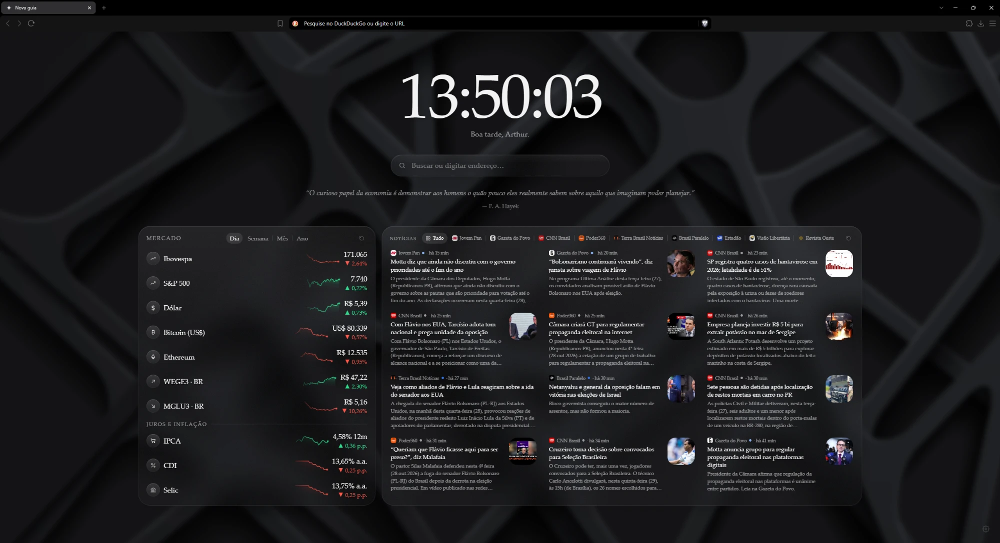

# Vitral

**Um redesign da nova guia do Brave (e do Chrome).** Em vez da página padrão, uma tela de vidro limpa, com relógio, busca, notícias das fontes que você escolher e o mercado do dia. Tudo cabe numa tela só, sem rolagem, e sem rastreamento.

## O que tem

- **Relógio e saudação**
- **Busca**, com mecanismos fixos (DuckDuckGo, Google, Brave, Startpage e outros) que você pode ligar, desligar e reordenar
- **Favoritos**: você adiciona pesquisando o site na web
- **Notícias** de várias fontes:
  - RSS, ou leitura direta de sites sem RSS
  - viés de cada fonte por cores
  - tradução automática
  - divisão igual entre as fontes
  - filtro "Peneira", que tira propaganda e notícias só com manchete
- **Mercado**:
  - moedas, ações, FIIs, ETFs, cripto e commodities
  - maior alta e maior baixa do dia por país
  - Selic, CDI e IPCA
  - minigráficos por período
- **Personalização**: fundo, vidro, cantos, tamanho e posição de cada bloco
- **Outros blocos**: notas, tarefas, links, contagem regressiva e citações

As configurações ficam só no navegador (`chrome.storage.local`).

## Instalar

1. Baixe o **`vitral-vX.Y.Z.zip`** da [versão mais recente](https://github.com/NotCapivara/vitral/releases/latest) e extraia numa pasta que você não vá apagar.
2. Abra `brave://extensions` (ou `chrome://extensions`) e ligue o **Modo do desenvolvedor**.
3. Clique em **Carregar sem compactação** e escolha a pasta **`vitral`** que saiu do zip.

Se você clonou o repositório para editar o código, escolha a pasta do clone e, depois de cada edição, clique em ↻ no cartão da extensão.

## Dados externos

Os dados de fora vêm de serviços gratuitos e sem cadastro:

| Dado | Serviço |
| --- | --- |
| Cotações | Yahoo Finance, CoinGecko, AwesomeAPI |
| Juros e inflação | Banco Central (SGS) |
| Ícones | DuckDuckGo |
| Nomes de sites | Wikidata |

Os sites de notícias só são acessados depois que você dá permissão para cada um.
